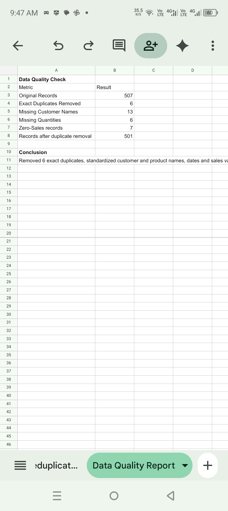
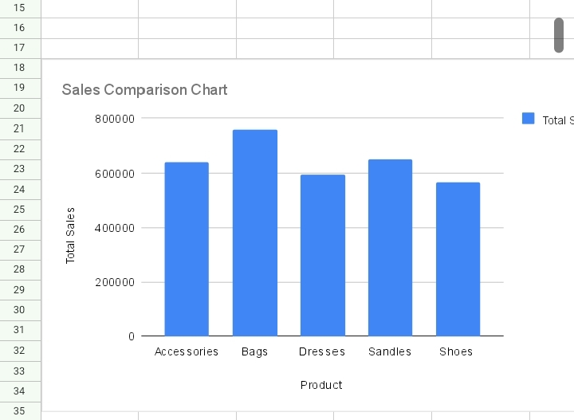
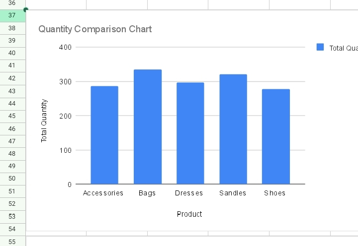
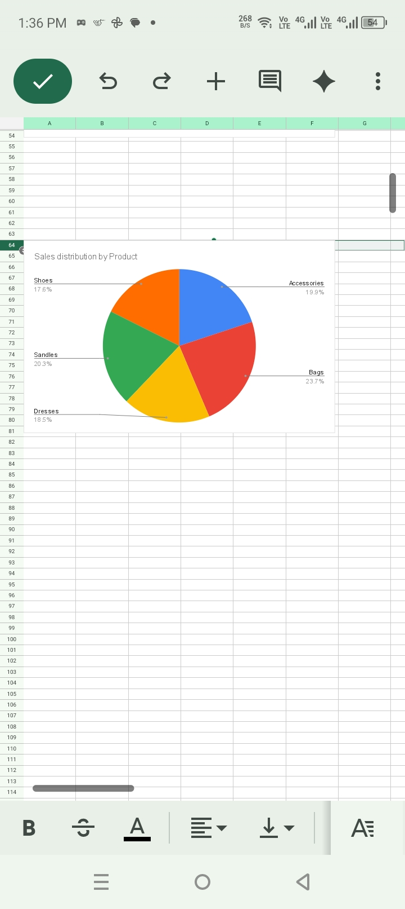

# E-commerce Data Cleaning Project

## Project Overview

This project focuses on cleaning and preparing a messy e-commerce orders dataset using Google Sheets.

The objective was to improve data quality, identify inconsistencies and prepare the dataset for further exploratory data analysis.

## Tools Used

- Google Sheets
- Spreadsheet formulas

## Data Cleaning Tasks

The following tasks were performed:

1. Identified and removed 6 exact duplicate records.
2. Identified 13 missing customer names.
3. Identified 6 missing quantity values.
4. Standardized inconsistent date formats.
5. Cleaned sales values containing currency symbols and text.
6. Identified 7 zero-sales records for further investigation.
7. Created a data quality report.

## Key Findings

- Original records: 507
- Exact duplicates removed: 6
- Records remaining: 501
- Missing customer names: 13
- Missing quantities: 6
- Zero-sales records: 7

Missing values and zero-sales records were flagged for further investigation rather than replaced with unsupported assumptions.

## Project Screenshots 

## Project Screenshots

### 1. Data Quality Report

### 2. Cleaned Dataset

### 3. Deduplicated Data

## Conclusion

This project provided practical experience in data cleaning, data quality assessment and spreadsheet-based data preparation.

The cleaned dataset will be used for further exploratory data analysis to investigate sales patterns, product performance and unusual sales figures.

### Next Steps

- Conduct exploratory data analysis (EDA).
- Investigate unusual sales figures.
- Analyze sales trends.
- Compare product performance.
- Generate business insights and recommendations.
---

Exploratory Data Analysis (EDA)

Exploratory Data Analysis was performed to examine product sales, quantities sold and overall product performance.

Project Visualizations

## Project Visualizations

### 1. Total Sales by Product

### 2. Total Quantity Sold by Product

### 3. Sales Distribution by Product

1. Total Sales by Product

File location: "images/1794911831545.jpg"

"Total Sales by Product" (images/1794911831545.jpg)

2. Total Quantity Sold by Product

File location: "images/1794911852127.jpg"

"Total Quantity Sold by Product" (images/1794911852127.jpg)

3. Sales Distribution by Product

File location: "images/Screenshot_20261117-133606.jpg"

"Sales Distribution by Product" (images/Screenshot_20261117-133606.jpg)

Key Findings

- Bags recorded the highest sales at KSh 760,800.
- Shoes recorded the lowest sales at KSh 566,400.
- Bags had the highest quantity sold at 334 units.
- Total sales amounted to KSh 3,213,700 across 1,517 units.

Business Recommendations

- Maintain adequate stock of high-performing products, particularly Bags.
- Review the sales performance of Shoes and explore opportunities to improve demand.
- Use sales trends to guide inventory planning.
- Investigate zero-sales records and missing quantities.

Conclusion

The analysis identified differences in product sales performance and purchasing patterns. The findings provide useful information for inventory planning and business decision-making.
